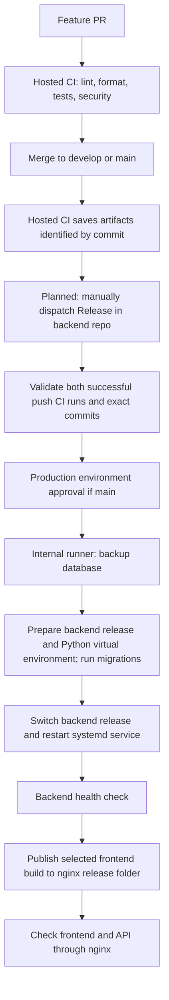

# HRMS resource management CI/CD

## Current status

CI is implemented. Deployment is NOT implemented or enabled until server discovery
confirms the operating system, SSH access, tools, database, addresses and free ports.
The pipeline uses GitHub Actions. nginx will serve the frontend build, and a
systemd service will run the backend from a release folder with its own Python
virtual environment. nginx configuration, systemd units and executable deployment
workflows have not been added. Blocking CI failures must be resolved before release. Temporary known-issue
exceptions are listed in docs/FOR_DEVELOPER.md; their steps remain visible.
TimeTracker is outside this project.

## Pipeline



## Release contract (to implement after discovery)

One `Release` workflow in hrms-backend will use `workflow_dispatch` only. It will
accept environment, backend CI run ID and frontend CI run ID. Staging accepts only
successful push runs from develop; production accepts only successful push runs
from main. Validate repository, CI workflow identity, event, conclusion, branch,
full commit SHA and artifact name before downloading. Never accept PR artifacts.
Use the same frontend artifact without rebuilding; VITE_API_URL=/api/v1 is public
build configuration, never a secret. nginx routes /api/v1 to the environment backend.

The backend GITHUB_TOKEN cannot read artifacts in another private repository.
Without a GitHub App, use an expiring fine-grained token restricted to
hrms-frontend, Actions: read, stored as FRONTEND_ARTIFACTS_TOKEN in each backend
GitHub Environment. It is for reading artifacts, not cross-repo workflow triggering.
Do not place it in source or print it. No automatic cross-repo triggering is planned.

The single coordinator downloads both artifacts and deploys backend before frontend.
Serialize each environment for the entire release, with cancel-in-progress: false.
Use protected deployment workflow code; restrict staging to develop and production
to main. Never run pull_request jobs on the deployment runner. Deployment jobs use
[self-hosted, linux, hrms-deploy]. Production requires approval before any server mutation.
Keep a release record mapping both commit SHAs and CI run IDs. Failed backend health
checks stop frontend deployment. Frontend failure requires a deliberate recovery decision.

## Proposed server layout

```text
/srv/hrms/{staging,production}/
  frontend/releases/<release-id>/
  frontend/current -> releases/<release-id>
  backend/releases/<release-id>/
    .venv/
  backend/current -> releases/<release-id>
  shared/backend.env
  shared/data/
  shared/backups/
```

Separate environment services, ports and databases. Backend ports are undecided
until discovery. Backends should bind to loopback behind nginx. Retain five
application releases; define database backup retention independently.

Each backend release contains its application code and a Python virtual environment
created at its final release path. Install backend dependencies into that environment.
The environment-specific systemd service uses backend/current as its working directory,
launches the server with backend/current/.venv/bin/python, and loads shared/backend.env.
After migrations, switch backend/current to the prepared release and restart the service,
then verify backend health before publishing the frontend. nginx serves frontend/current
and forwards API requests to the backend loopback port. Virtual environments and
environment files stay on the server and are excluded from Git and CI artifacts.

## Server installation plan: Ubuntu 20.04

Install nginx through apt. Install Python 3.10 alongside the system Python 3.8;
keep /usr/bin/python3 and the operating system interpreter unchanged. Check apt
package availability before choosing a Python source. If Python 3.10 packages are
unavailable, use a verified CPython 3.10 source release with a dedicated /opt prefix
and make altinstall. Do not assume an older third-party PPA still supports Focal.
Use the explicit Python 3.10 executable to create each backend release's .venv.
Development, CI, lint/format targets and backend services all use Python 3.10.
Run installation commands one at a time after inspecting the previous result.

## Database and startup follow-up

Set BOOTSTRAP_DEMO_DATA=false and ENABLE_INTERNAL_SCHEDULER=false explicitly in
both environments. All other required configuration must be supplied: blank values
in .env.example are names to fill, not a runnable environment file. Use distinct
strong SECRET_KEY values and separate DATABASE_URL values. CORS_ORIGINS is unused
by the application CORS middleware; wildcard CORS is the accepted internal policy.
Production uses same-origin /api/v1 through nginx.
Do not introduce multiple scheduler workers accidentally. Decide the scheduled job
strategy during server discovery.

Startup still calls create_all, local schema upgrades and demo bootstrap. Demo data
is disabled by configuration, but startup can still change schema. Follow-up:
review all schema upgrades and move database mutations into explicit migration or
administration commands, with separate approval. Until then, do not claim migrations
are fully controlled or deploy overlapping application versions against one DB.

Before production: determine current migration state and a safe baseline, rehearse
migrations on a copy, take a database-native consistent backup and test restoration.
The CI migration check uses fresh SQLite because current tests use SQLite. It does
not establish compatibility with a different server database. Add matching database
CI and a driver after discovery if required. Deploy backward-compatible schema
changes so the previous application can still work. Never auto-downgrade a database.

## Rollback (deployment commands pending discovery)

Stop the release if migrations or health checks fail. Save logs without secrets.
For frontend, switch current atomically to a retained release, validate nginx and
reload it, then check frontend routing and API access. For backend, select the
previous release folder with its existing Python virtual environment, switch
backend/current to it, and restart the systemd service only if that release supports
the migrated schema.
Otherwise stop writes and use the tested database restore procedure with explicit
approval; restoring a backup can lose newer data. Application rollback does not
undo schema changes. Exact commands will be supplied after discovery.

## GitHub setup checklist

1. Keep both repositories private; create backend empty, without GitHub-generated files.
2. Review local changes before staging. Never stage .env, venv, node_modules,
   databases, backups or private keys. Backend .env.example has names only.
3. Ask the owner before any git push. No commits or pushes have been made for this setup.
4. Create main/develop for the new backend through an agreed initial commit process.
   Frontend already has these branches. Work remains on feature/cicd-setup.
5. Settings > Environments > New environment: create staging and production in
   hrms-backend. Restrict deployment branches to develop/main respectively. Enable
   required production reviewers and prevent self-review if supported by your plan.
   If private-repo approval gates are unavailable, keep production deployment disabled
   until a supported approval mechanism is agreed. Manual dispatch alone is not a gate.
6. Add environment secrets under Settings > Environments > environment >
   Environment secrets > Add secret. Add nonsecret configuration under variables.
   Determine final SSH/database secret names only after discovery.
7. Settings > Branches > Add branch protection rule: separately protect main and
   develop in both repos. Require a pull request, one approval, status checks,
   resolved conversations; disable force pushes and deletion. Require `Frontend CI`
   in frontend and `Backend CI` in backend. Select them after a first CI run registers
   the checks. Apply rules to administrators where supported; verify plan availability.
8. Review Dependabot pull requests; action revisions are pinned to full commit SHAs.
9. Notifications are deferred; no Slack/email credentials or outbound messaging added.

## Runner registration (do not run server commands yet)

After server approval, create a dedicated non-root account `hrms-runner`; use a
separate deployment account if the runner is on another machine. Do not run Actions
as root or grant unrestricted sudo. Limit deployment permissions to the environment
release folders and the specific systemd service operations needed for deployment.

In hrms-backend: Settings > Actions > Runners > New self-hosted runner > Linux >
choose discovered architecture. Run GitHub's displayed download and configuration
commands as hrms-runner in its own runner directory. Keep the short-lived registration
token private. During configuration set name `hrms-deploy-188`, accept default
self-hosted/linux labels, add custom label `hrms-deploy`, and choose a work directory.
Use GitHub's current runner version rather than copying a stale download URL.

An administrator then installs the supplied service with `sudo ./svc.sh install
hrms-runner`, starts it with `sudo ./svc.sh start`, and checks `sudo ./svc.sh status`.
Restart from the runner installation directory with `sudo ./svc.sh stop` then
`sudo ./svc.sh start`. These are future instructions, not commands to run now.
Confirm the runner is Idle in GitHub. It needs outbound HTTPS to GitHub and artifact
services; no inbound internet port is required. Keep OS and runner updated, restrict
repository write access, and never execute untrusted PR code on this machine.

## SSH keys (only if deployment crosses machines)

After discovery, generate a dedicated Ed25519 deployment key on a trusted machine.
Install the public key in the deployment user's ~/.ssh/authorized_keys; keep directory
permissions 700 and file permissions 600. Store the private key only in the appropriate
GitHub Environment secret. Verify the server host-key fingerprint through a trusted
channel before storing known_hosts; never disable host-key checking. Restrict key
forwarding/PTY and deployment privileges as appropriate. Never share the server password.
If the runner deploys locally, SSH credentials need not exist at all.

## Daily workflow

```bash
git checkout develop
git checkout -b feature/your-task
# Edit, review git diff and git status, and commit intentionally selected files.
# Ask for authorization before pushing during this assisted setup.
git push -u origin feature/your-task
```

Open a PR into develop, get green CI and review, then merge. A production release
starts with a reviewed develop-to-main PR. Deployment will be manual, for both
environments, under the current simplified release policy.

## Troubleshooting

- Lint/format: inspect failing files; do not autoformat application code without approval.
- Coverage: frontend needs @vitest/coverage-v8 matching the installed Vitest version.
- Dependency audit: fix findings through reviewed dependency updates, not ignored failures.
- Migration failure: preserve the backup and logs; do not repeatedly restart against a damaged DB.
- CORS: wildcard policy is accepted for internal deployment; CORS_ORIGINS is unused
  by the application CORS middleware. Production uses same-origin /api/v1 via nginx.
- API errors: verify nginx preserves /api/v1 when forwarding requests.
- Pending runner: check labels, service status and outbound network access.
- Missing artifact: confirm successful push CI and retention window; never rebuild during release.
- Release button absent: workflow_dispatch must be on the repository default branch first.
- Secret accidentally committed: revoke/rotate it immediately; deletion alone is insufficient.
